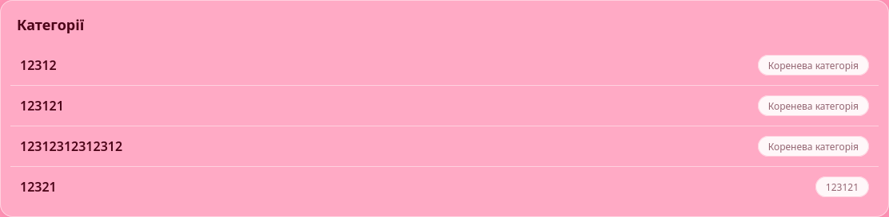
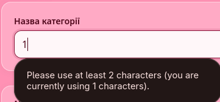

# Лабораторна робота №6

## Інтеграція клієнтської сторінки з REST API

### 1. Назва проєкту та склад команди

**Назва проєкту:** Інтернет-магазин.

**Склад команди:**

| ПІБ учасника    | GitHub-акаунт                                      |
| --------------- | -------------------------------------------------- |
| Рудь Максим     | [@awaikoi](https://github.com/awaikoi)             |
| Шутовська Марта | [@YotsubaNikano](https://github.com/YotsubaNikano) |
| Комарук Марк    | [@ItsukiNikano](https://github.com/ItsukiNikano)   |
| Засєкін Ілля    | [@NikanoNino](https://github.com/NikanoNino)       |
| Ковтун Каріна   | [@k7912341-bit](https://github.com/k7912341-bit)   |

### 2. Опис демонстраційної сторінки

Для демонстрації взаємодії з REST API створено сторінку керування категоріями товарів (`/api-demo`).

Сторінка дозволяє отримувати та відображати список категорій, додавати нові категорії, а також вказувати батьківську категорію для створення ієрархічної структури. Взаємодія з сервером відбувається асинхронно за допомогою JavaScript та Fetch API без перезавантаження сторінки.

### 3. Використані ендпоінти API

Для роботи демонстраційної сторінки використовуються такі ендпоінти:

| Метод | Ендпоінт             | Призначення                |
| :---: | -------------------- | -------------------------- |
|  GET  | `/api/v1/categories` | Отримання списку категорій |
| POST  | `/api/v1/categories` | Створення нової категорії  |

**Поля відповіді GET `/api/v1/categories`:**

| Поле          | Тип            | Опис                                 |
| ------------- | -------------- | ------------------------------------ |
| `id`          | Integer        | Унікальний ідентифікатор категорії   |
| `name`        | String         | Назва категорії                      |
| `parent_id`   | Integer / null | Ідентифікатор батьківської категорії |
| `parent_name` | String / null  | Назва батьківської категорії         |

**Поля запиту POST `/api/v1/categories`:**

| Поле        | Тип            | Опис                                            |
| ----------- | -------------- | ----------------------------------------------- |
| `name`      | String         | Назва нової категорії                           |
| `parent_id` | Integer / null | Ідентифікатор батьківської категорії або `null` |

Назва категорії повинна містити від 2 до 100 символів. У разі успішного створення сервер повертає HTTP-статус `201 Created` та інформацію про створену категорію.

У разі помилки API повертає об'єкт із такими полями:

| Поле            | Опис                              |
| --------------- | --------------------------------- |
| `error.code`    | Код помилки                       |
| `error.message` | Повідомлення про помилку          |
| `error.details` | Додаткова інформація, якщо вона є |

### 4. Розташування файлів у проєкті

Основні файли, які забезпечують роботу демонстраційної сторінки:

| Файл                       | Призначення                                |
| -------------------------- | ------------------------------------------ |
| `templates/api-demo.html`  | HTML-шаблон демонстраційної сторінки       |
| `static/js/api-demo.js`    | JavaScript-логіка взаємодії з API          |
| `static/js/api.js`         | Загальна функція для виконання API-запитів |
| `routes/api/categories.py` | Серверна реалізація ендпоінтів категорій   |
| `models.py`                | Робота з базою даних та категоріями        |

HTML-шаблон використовує базовий шаблон `base.html`, а JavaScript-файл підключається через блок `scripts`.

### 5. Скріншоти роботи сторінки

#### 5.1. Список категорій

#### 5.2. Додавання нового запису

#### 5.3. Повідомлення про успішне виконання операції

#### 5.4. Повідомлення про помилку

### 6. Висновки

Під час виконання лабораторної роботи було реалізовано взаємодію клієнтської сторінки з REST API за допомогою JavaScript та Fetch API. Було використано GET-запит для отримання списку категорій та POST-запит для створення нових записів. Реалізовано асинхронне оновлення вмісту сторінки без її перезавантаження, а також відображення повідомлень про успішне виконання операцій і помилки. У результаті роботи було закріплено практичні навички інтеграції клієнтської частини вебзастосунку із серверним API.
